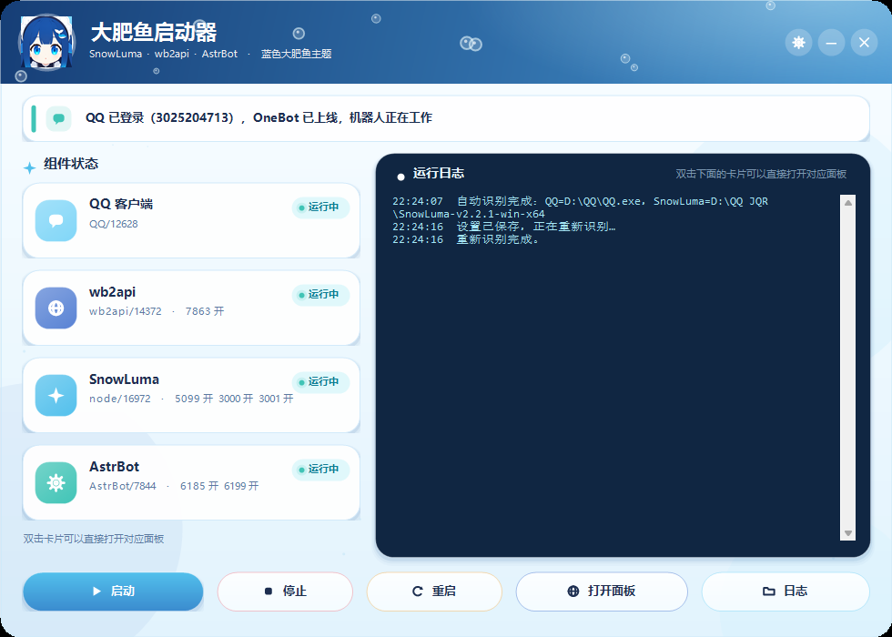
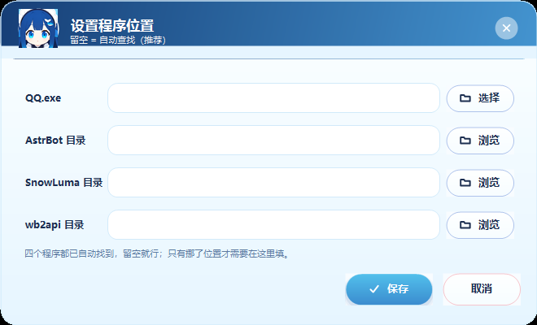

# 大肥鱼启动器

给 QQ 机器人做的一个 Windows 桌面启动器：把 **QQ → wb2api → SnowLuma → AstrBot** 四个东西按顺序拉起来，
用卡片看端口和运行状态，日志直接在窗口里滚动，不用再开一堆黑窗口手敲命令。



## 特性

- **一个 exe，双击即用**：C# WinForms，编译成单文件，只依赖 Windows 自带的 .NET Framework 4.x，不需要装运行时。
- **按顺序启动**：QQ → wb2api → SnowLuma → AstrBot，前一步起来了才走下一步，卡在哪一步日志里能看见。
- **自动找路径**：配置里写了就用配置；路径失效才依次查注册表安装项、资源管理器的历史路径、常见安装位置，最后才浅扫盘（硬上限 10 秒）。
- **状态实时刷新**：每 2.5 秒检查一次进程和端口，卡片上显示「运行中 / 未运行」和真实端口。
- **SnowLuma 自动挂载**：启动 SnowLuma 时通过环境变量 `SNOWLUMA_HOOK_AUTOLOAD=1` 打开自动加载，**不改动 SnowLuma 自己的配置文件**。
- **界面全部自绘**：渐变、水泡、卡片、按钮都是 `Graphics` 手画，没有用任何第三方 UI 库；看板娘立绘作为资源嵌在 exe 里。
- **配置写得安全**：先写 `config.ini.tmp`，成功后才替换原文件，中途出错不会把配置写坏。

## 截图

路径设置窗口（右上角齿轮打开，改完点保存即可，不用手改配置文件）：


## 使用

1. 下载或自己编译出 `大肥鱼启动器.exe`，和 `AstrBot / SnowLuma / wb2api` 三个文件夹放在同一层目录（放在上一级也行）。
2. 双击运行。第一次打开会自动找各组件的路径，结果显示在日志里。
3. 点底部【启动】。QQ 第一次需要扫码登录；登录后 SnowLuma 会自动挂上。
4. 关窗口只是关界面，机器人继续跑；要停机点【停止】（默认不关 QQ，避免掉线）。

详细的中文操作说明见 [使用说明.txt](使用说明.txt)。

## 编译

不需要 Visual Studio，也不需要 .NET SDK，用 Windows 自带的编译器即可：

```powershell
powershell -ExecutionPolicy Bypass -File build.ps1
```

产物是根目录下的 `大肥鱼启动器.exe`。`app.ico`（多尺寸图标）和 `WhaleAvatar.png`（看板娘）会被一起打进 exe；
没有这两个文件也能编过，只是没有图标和头像。

想换图标：把一张 1024×1024 的 PNG 交给 `tools\make-icon.ps1`，它会生成 `app.ico` 和 `WhaleAvatar.png`。

```powershell
powershell -ExecutionPolicy Bypass -File tools\make-icon.ps1 -Source 你的图.png
```

## 配置

设置保存在 exe 旁边的 `config.ini`，第一次运行会自动生成：

```ini
# 大肥鱼启动器：留空 = 自动查找
QQPath=
AstrBotDir=
SnowLumaDir=
Wb2apiDir=
```

- 留空 = 自动查找；填了就按填的走。
- 支持相对路径，例如 `..\SnowLuma-v2.2.1-win-x64`（相对 exe 所在目录）。
- 也可以点窗口右上角的齿轮在界面里改，效果一样。清空某一项 = 这一项重新自动查找。
- 模板见 [config.example.ini](config.example.ini)。

## 项目结构

```
src/            主程序源码（C# / WinForms）
  Launcher.cs     启动、停止、重启、路径识别、配置读写、端口探测、命令行入口
  MainForm.cs     主窗口：状态卡片、日志面板
  SettingsForm.cs 设置窗口：四个路径
  Mascot.cs       看板娘立绘与动画
  Theme.cs        配色、圆角卡片、按钮等自绘控件
tools/
  make-icon.ps1   把一张 PNG 做成多尺寸 ico + 圆形头像
build.ps1       用系统 csc 编译
docs/           README 用的截图
```

## 运行环境

| 项目 | 说明 |
|---|---|
| 系统 | Windows 10 / 11（x64） |
| 运行时 | .NET Framework 4.x（系统自带，无需安装） |
| QQ | QQ NT 桌面版 |
| 组件 | 已经适配 SnowLuma v2.2.1、wb2api-panel v1.13.0、AstrBot 4.29.3，其它相近版本一般也能用 |

## 注意

程序本身只做「拉起进程 + 查端口 + 读日志」，不上传任何数据，不联网（除打开本机面板网址）。

但如果你要把自己用的整套目录分享出去，**不要**顺手带上这些：

- `config.ini`：里面是你的本机路径
- `logs/`、`SnowLuma/` 下的日志和 `data/`：可能有 QQ 号和聊天内容
- SnowLuma 的 `config/`：包括面板密码哈希和 accessToken
- `C:\Users\<用户名>\.astrbot`：机器人配置和模型 API Key

本仓库的 `.gitignore` 已经默认忽略 `config.ini`、`logs/`、`*.exe` 等文件。

## 许可

[MIT](LICENSE)
